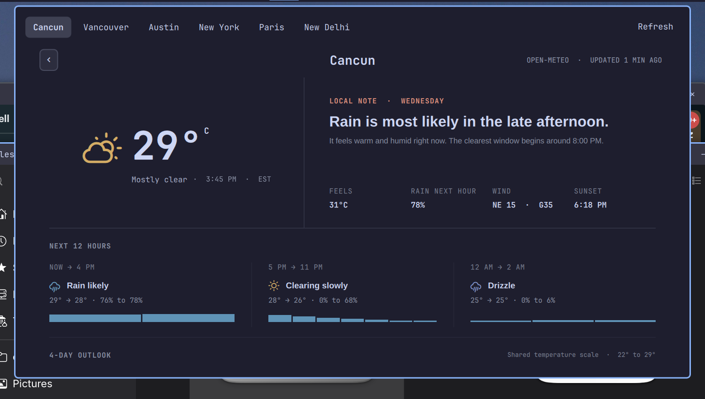

# Weather for Omarchy

The [World Clock](https://github.com/olivoil/omarchy-world-clock) weather
detail panel as a standalone Omarchy bar plugin — no Rust backend, no
clock. Pure QML against Open-Meteo.



## Install

```bash
omarchy plugin add https://github.com/olivoil/omarchy-weather --enable
```

Requires the Elsewhen world clock (`omarchy.elsewhen`) in your bar: this
plugin reads its locations, home city, and units (see below). To remove:
`omarchy plugin remove io.github.olivoil.weather`.

## What it shows

- **Bar**: home's condition glyph and temperature.
- **Panel**: the full World Clock weather detail (narrative, next 12
  hours, metric graph, 4-day outlook, sun times) for the selected
  location. It always opens on home.

## Where locations come from

This plugin has no location settings of its own. It reads the official
world clock, **Elsewhen** (`omarchy.elsewhen`), live from
`~/.config/omarchy/shell.json`:

- **List**: every zone in Elsewhen's `zones` setting, with home first.
- **Home**: Elsewhen's `homeCity` override, or — when blank, as
  Elsewhen itself resolves it — the city named by the system time zone.
- **Units / 12-24h**: Elsewhen's `units` and `hour24` settings.

Change cities or home in Elsewhen and this panel follows on the next
shell.json save; there is nothing to keep in sync by hand.

Coordinates come from the Open-Meteo geocoder (a result in the row's own
time zone wins), with `/usr/share/zoneinfo/zone1970.tab` as the offline
fallback — the same resolution Elsewhen uses. Weather comes from
Open-Meteo with the same request the World Clock backend made.

## Controls

| Input | Action |
| --- | --- |
| Click bar widget | Toggle panel (opens on home) |
| Middle-click | Refresh weather now |
| Click a location chip | Show that location |
| ← / → | Previous / next location |
| ↑ / ↓ (or j / k) | Scroll the detail |
| Esc | Close |

IPC: `omarchy-shell io.github.olivoil.weather open|close|toggle|refresh|status`

## Internals

- `WeatherDetail.qml`, `WeatherDetailLogic.js`, and
  `WeatherMetricGraph.qml` are copied verbatim from the World Clock
  plugin; `Panel.qml` is a new controller implementing the interface
  they read, and `Model.js` shapes Open-Meteo responses exactly like
  the World Clock Rust backend did.
- For local development, symlink this checkout into the plugin
  directory so edits hot-reload in the shell:

  ```bash
  ln -s "$PWD" ~/.config/omarchy/plugins/io.github.olivoil.weather
  omarchy bar put io.github.olivoil.weather --after omarchy.elsewhen
  ```
- The one setting is `refreshMinutes` (default 15): the panel refreshes
  weather in the background on that period so the bar temperature stays
  current. A failed fetch keeps stale data visible and backs off for
  two minutes.
- Strings are English, matching the copied World Clock view.

## Tests

```bash
node test/model.test.cjs
```

Covers Elsewhen-settings parsing, home resolution, the `date` probe,
coordinate fallbacks, and Open-Meteo shaping against a recorded live
response (`test/open-meteo.fixture.json`).
